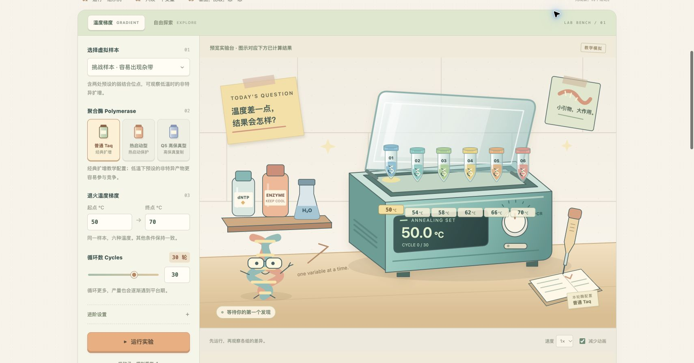

# PCR Playground

[简体中文](README.zh-CN.md) · [Asset credits](docs/ASSETS.md) · [Verification](docs/VERIFICATION.md)

An interactive PCR teaching simulation. Change a few settings, watch a small illustrated lab react, and compare how the model distributes **relative yield** between target product, nonspecific product, and primer dimers.

This is a teaching model, not a calibrated prediction of a real reaction. The curves are simulated; they are not measured qPCR data.



## Explore

- **Temperature gradient:** compare simulated outcomes across a range of annealing temperatures.
- **Free exploration:** adjust a condition and inspect how the curves and three product classes change.
- Switch between **Toy Lab** and **Comic Notebook** themes.
- Keep experiment history in your browser with `localStorage`.
- Export a CSV table, a PNG figure, or a JSON project; import JSON to restore a project.

Inputs and calculations are processed in the browser. Saved history belongs to the current browser and origin; clearing site data removes it. Export JSON to keep a separate copy.

## Run locally

Use Node.js 24 or newer for checks and builds, and Python 3 for the development server. There are no npm dependencies to install.

```sh
npm run dev
```

Open `http://localhost:4173`. Serve the files over HTTP because the app uses JavaScript modules.

```sh
npm test
npm run build
```

The build writes a static site to `dist/`: `index.html`, the root JavaScript modules, `style.css`, optional `assets/`, and `.nojekyll`. Tests, documentation, and development scripts are excluded.

## Read the results

Compare the direction and relative size of changes within the simulation. A higher curve does not specify DNA concentration, copy number, Ct/Cq, or an experimentally established optimum. The three product classes are simplified teaching categories. Real PCR also depends on sequence, reagent formulation, instrument behavior, and sample quality, which this model does not fully represent.

Use a real experiment and appropriate controls to test an experimental conclusion. The app's verification status is recorded in [docs/VERIFICATION.md](docs/VERIFICATION.md).

## Deployment

The repository contains a GitHub Pages workflow. Once the repository exists, select **GitHub Actions** as the Pages source in repository settings. A push to `main`, or a manual **Deploy Pages** run, checks the model, builds `dist/`, and deploys the artifact.

Source repository: [X-Dice/pcr-playground](https://github.com/X-Dice/pcr-playground). Deployment status is recorded in the verification log.

## Project layout

| File | Purpose |
| --- | --- |
| `model.js` | Teaching model and simulation calculations |
| `app.js` | Application state and controls |
| `scene.js` | Illustrated laboratory scene |
| `charts.js` | Result charts |
| `exports.js` | File export and import |
| `style.css` | Layout and themes |
| `tests/` | Automated checks |
| `scripts/build.mjs` | Dependency-free static build |

Original vector illustrations and interface artwork are described in [asset credits](docs/ASSETS.md). Licensed under [MIT](LICENSE), copyright 2026 X-Dice.
